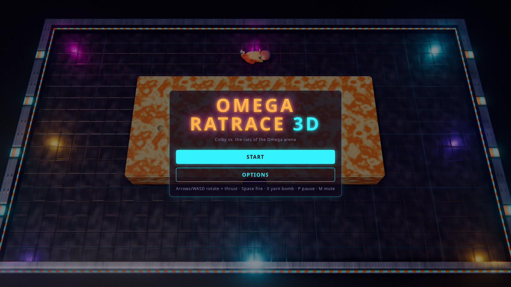
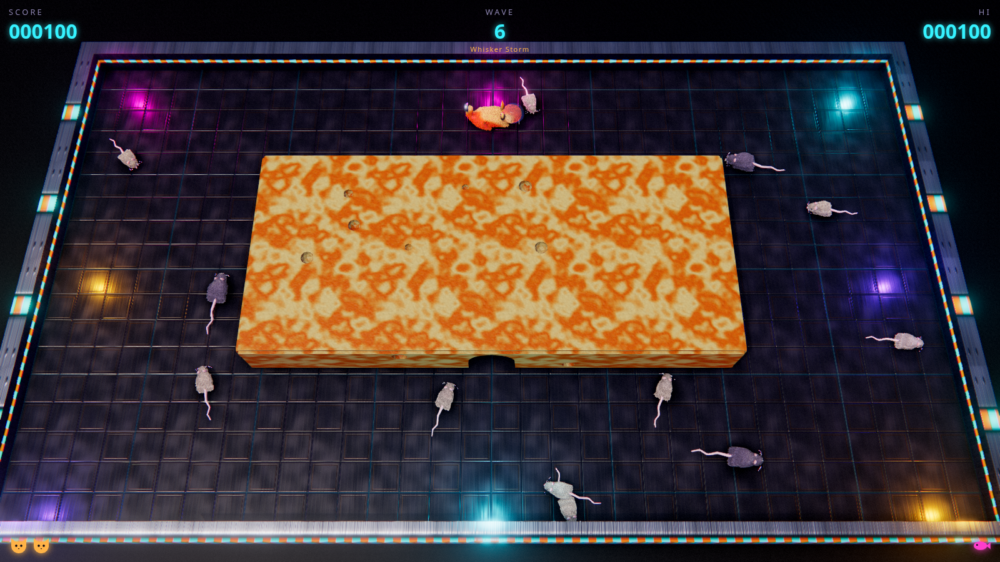
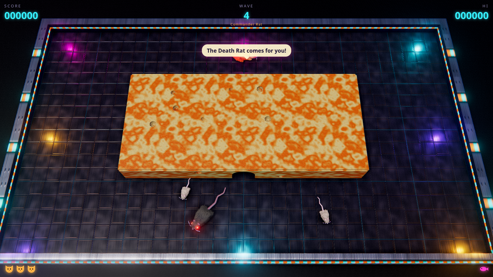
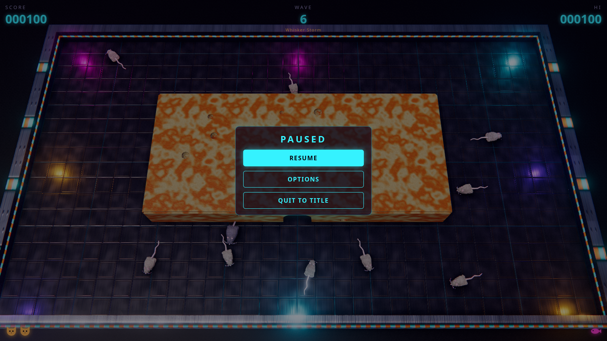
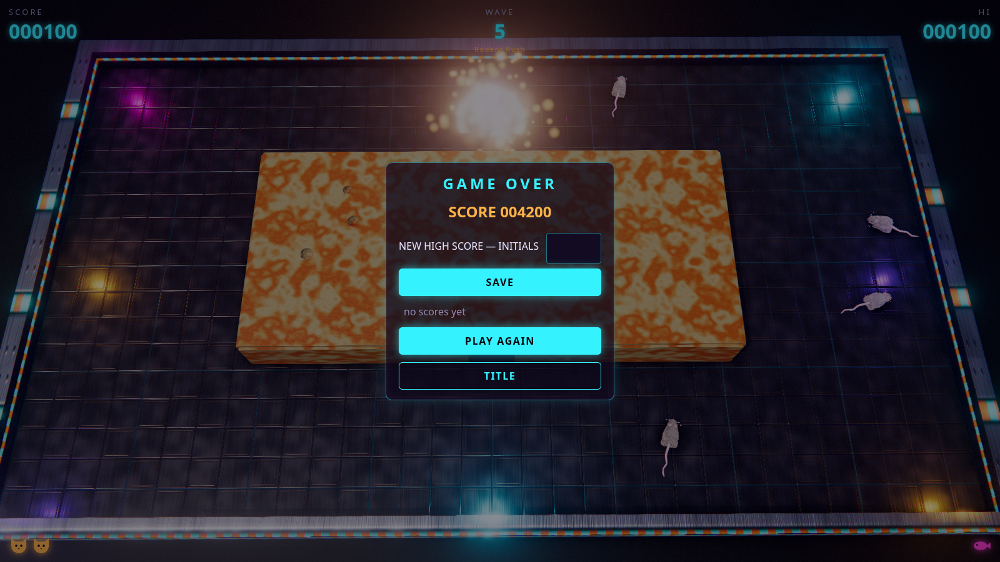
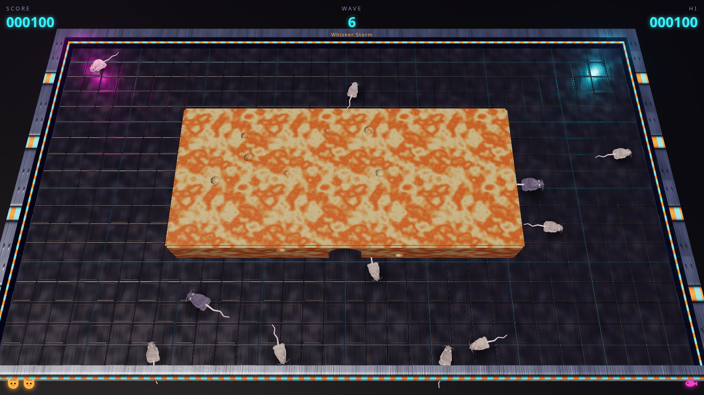
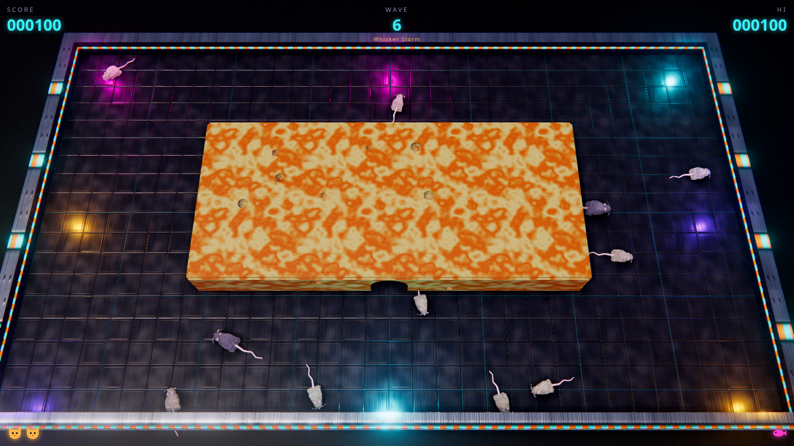

# Omega Ratrace 3D

[](https://bsommers.github.io/omega-ratrace-3d/play/)
[](https://bsommers.github.io/omega-ratrace-3d/)


A photoreal 3D take on the Vic-20 *Omega Race*, set in the Colby Jack cat universe (sibling of catxzzon/duum). You fly **Colby**, a marbled orange and cream cat who is also the spaceship, around a rectangular rail arena with a central cheese "Mouse Hole". Mice, rats and commanders chase her. Tail is the engine.

**Play: https://bsommers.github.io/omega-ratrace-3d/play/**  |  Site: https://bsommers.github.io/omega-ratrace-3d/

## Screenshots

| Title | Gameplay | Death Rat |
|---|---|---|
|  |  |  |
| **Pause** | **Game over** | **Quality: low / ultra** |
|  |  |   |

Model renders: [`docs/screenshots/models/contact-sheet.png`](docs/screenshots/models/contact-sheet.png).

## Features

- Newtonian rotate / thrust / drag flight, ricocheting shots, wall bounces off the outer rail and the central box. Deterministic: same seed plus same inputs gives the same state.
- Enemies: droid mice, chaser rats, commander rats (pellet bursts, drop tuna), drifting cheese mines, and the unkillable Death Rat that arrives after 42 s of a wave.
- Tuna pickups (+500, +1 yarn bomb, max 3), combo scoring, extra lives at 10k, 30k and every 30k.
- Eleven Blender-authored models (glTF 2.0 PBR) with procedural fallbacks if a file is missing.
- Post stack: ACES tone mapping, bloom, GTAO, SMAA, colour grade, PMREM environment, cast shadows. FPS-driven auto-downgrade between quality tiers.
- Procedural WebAudio SFX and music (no audio files). Keyboard, gamepad and touch input.
- Every model also ships as a watertight, single-shell STL for 3D printing.

## Controls

| Action | Keyboard | Gamepad / touch |
|---|---|---|
| Rotate | Left / Right or A / D | left stick or d-pad / left-half steer pad |
| Thrust | Up or W | A, R1 or R2 / THRUST button |
| Fire | Space | X, B or L2 / FIRE button |
| Yarn bomb | X or B | Y or L1 / BOMB button |
| Pause | P or Esc | Start |
| Mute | M | |
| Confirm | Enter | |

See [docs/HOW-TO-PLAY.md](docs/HOW-TO-PLAY.md).

## URL parameters

| Param | Effect |
|---|---|
| `autostart=1` | skip the title screen |
| `seed=N` | deterministic RNG seed |
| `wave=N` | start at wave N |
| `quality=low\|medium\|high\|ultra` | render tier (default high) |
| `bot=1` | autopilot plays |
| `debug=1` | FPS overlay |
| `mute=1` | start muted |

Example: `play/?autostart=1&seed=1&quality=ultra&bot=1`

## Quality tiers

| Tier | Post | GTAO | Shadows (map) | Pixel ratio | Particles |
|---|---|---|---|---|---|
| low | off | off | off | 1 | 1024 |
| medium | bloom + grade | off | 1024 | 1 | 2048 |
| high | bloom, SMAA, grade | on | 2048 | 1.5 | 4096 |
| ultra | all | on | 4096 | 2 | 8192 |

Source of truth: `src/render/quality.js`.

## Run locally

Needs Node 22+. No install, no bundler.

```
node tools/serve.mjs                 # dev server for the repo root, open index.html
npm test                             # full suite
node tools/check-imports.mjs         # import graph lint
node tools/botplay.mjs               # headless deterministic bot run
node tools/shot.mjs --url "/index.html?autostart=1&seed=1&quality=high" --out out/shots/x.png
node tools/build-site.mjs            # dist/site (landing + play/ + stl/)
```

## Project layout

```
index.html style.css src/main.js     entry, fixed-step loop
src/core/    defs (frozen), rng, events, settings, input
src/sim/     game, player, shots, collide, score, waves, enemies, autopilot   (no three.js, no DOM)
src/render/  renderer, scene, arena, entities, camera, post, lighting, fx, quality
src/audio/   audio, sfx, music
src/ui/      hud, screens, menus, font
assets/      models/*.glb  print/*.stl  textures/  manifest.json
tools/       blender/*.py  validate-assets  build-web  build-site  serve  shot  botplay  swarm-tracker
vendor/three vendored three.js + addons
docs/        ASSETS BUILD HOW-TO-PLAY ARCH-OVERVIEW LEARNINGS INTEGRATION-NOTES  site/  screenshots/  swarm/
```

Binding design contract: [ARCHITECTURE.md](ARCHITECTURE.md). Overview: [docs/ARCH-OVERVIEW.md](docs/ARCH-OVERVIEW.md).

## Asset pipeline and STL printing

`blender -b -P tools/blender/{colby,mice,props,arena}.py` writes `assets/models/<name>.glb` and `assets/print/<name>.stl`. `node tools/validate-assets.mjs` checks glTF validity, triangle budget (<= 40k), and that each STL is a single watertight shell, then rewrites the table in [docs/ASSETS.md](docs/ASSETS.md). STLs are in millimetres; Colby is about 133 mm long. Print them from `assets/print/` or `/stl/` on the site (about 62 MB total). Minimum wall thickness per model is listed in ASSETS.md; the thinnest walls (mouse 1.7 mm, rat 1.9 mm) are the ones to check in your slicer.

## Build and deploy

`.github/workflows/pages.yml` runs tests, builds `dist/site`, and deploys to GitHub Pages on push to `main`. See [docs/BUILD.md](docs/BUILD.md).

## Swarm tracker

The project was built by a parallel agent swarm. Progress and reports live in `docs/swarm/` and `.tracker/`. Dashboard: `npm run plan && npm run tracker` (port via `TRACKER_PORT`, default 4792). Lessons: [docs/LEARNINGS.md](docs/LEARNINGS.md).

## Credits

Gameplay after Vic-20 *Omega Race* (Midway, 1981). Colby Jack cat universe shared with catxzzon/duum. Rendering by [three.js](https://threejs.org) (MIT, vendored). Models, audio and code generated in-repo (Blender scripts, procedural WebAudio).

## License

Apache-2.0, see [LICENSE](LICENSE). three.js is MIT.
